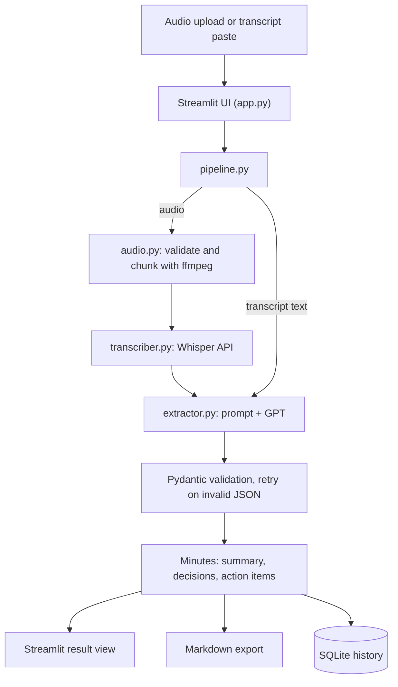

# MeetMinutes AI

**Automated Meeting Minutes Generator for Hindi, English and Hinglish meetings.**
Upload a meeting recording (or paste a transcript) and get structured English minutes: a summary, key decisions, and action items with owners and deadlines.

> **Status:** 🚧 In active development (2-week build). Checkboxes in the [Roadmap](#roadmap) show what is done.

---

## Why this project

Writing minutes of meeting (MoM) by hand is slow and often skipped. In India, meetings are frequently held in Hindi or a Hindi-English mix, which most note-taking tools handle poorly. MeetMinutes AI turns the raw recording into clean, English, structured minutes without any manual typing.

## Features

- 🎙️ Audio to transcript using OpenAI Whisper
- 🌐 Multilingual input: Hindi, English, Hinglish (auto-detect or manual selection)
- 🇬🇧 Output in English, or in the meeting's own language
- 📝 Structured minutes: title, summary, key points, decisions, action items
- ✅ Action items with `owner` and `deadline` (set to `null` when not stated, never guessed)
- 📅 Relative dates like "kal" or "next Friday" resolved using the meeting date
- 📄 Original transcript viewer and Markdown export
- 🗂️ Meeting history stored in SQLite

## How it works

1. **Transcribe**: Whisper converts the audio into a transcript in its original language.
2. **Extract**: GPT reads the transcript with a carefully engineered prompt and returns JSON.
3. **Validate**: Pydantic checks the JSON. If it is invalid, the app retries with a repair prompt.
4. **Present**: Streamlit shows the minutes, and they can be exported or saved to history.

No model training or fine-tuning is involved. The quality of the output comes from prompt engineering, and each prompt version is evaluated against a labeled test set.

## Architecture



The app is a **modular monolith**: one Python process, with the UI (`app.py`) calling only `pipeline.py`. Each stage is its own module, so any of them (for example the transcriber) can be swapped without touching the rest.

## Tech stack

| Layer | Tool |
|---|---|
| Language | Python 3.12 |
| Speech-to-text | OpenAI Whisper API |
| Extraction | OpenAI GPT (chat completions, JSON mode, temperature 0) |
| Validation | Pydantic |
| UI | Streamlit |
| Audio handling | ffmpeg, pydub |
| Storage | SQLite |
| Config | python-dotenv |

## Prompt engineering approach

The extraction prompt (kept in `prompts/`, versioned) uses:

- Role prompting and explicit rules
- Clear definitions of *decision* vs *action item*
- Few-shot examples, including a Hinglish example
- A strict null policy: if an owner or deadline is not stated, return `null`
- Context injection: the meeting date is passed in so relative dates can be resolved
- Structured output (JSON schema) with Pydantic validation and a repair-retry loop

## Output schema

```json
{
  "title": "Q4 Launch Planning",
  "detected_language": "mixed",
  "summary": "...",
  "key_points": ["..."],
  "decisions": ["..."],
  "action_items": [
    { "task": "Fix the API", "owner": "Rahul", "deadline": "2026-10-21" }
  ]
}
```

## Project structure

```
MinutesofMeetings/
├── app.py                  # Streamlit UI
├── models.py               # Pydantic schemas
├── db.py                   # SQLite history
├── services/
│   ├── audio.py            # file validation, ffmpeg chunking
│   ├── transcriber.py      # Whisper API call
│   ├── extractor.py        # prompt building, GPT call, validation, retry
│   ├── pipeline.py         # orchestrates the steps
│   └── exporter.py         # Markdown export
├── prompts/                # versioned system prompts (v1, v2, ...)
├── eval/                   # labeled test cases and scoring script
├── data/                   # sample audio and transcripts
├── exports/                # generated minutes (git-ignored)
├── requirements.txt
└── .env.example
```

## Getting started

### Prerequisites

- Python 3.12+
- `ffmpeg` installed on your system
- An OpenAI API key

On Ubuntu/Debian:

```bash
sudo apt update
sudo apt install -y python3 python3-venv python3-pip ffmpeg git
```

### Installation

```bash
git clone https://github.com/SrishtiDev/MinutesofMeetings.git
cd MinutesofMeetings

python3 -m venv venv
source venv/bin/activate

pip install --upgrade pip
pip install -r requirements.txt
```

### Configuration

```bash
cp .env.example .env
# then open .env and set your key:
# OPENAI_API_KEY=your-key-here
```

Never commit your `.env` file. It is already listed in `.gitignore`.

### Run

```bash
streamlit run app.py
```

Open the URL shown in the terminal (usually `http://localhost:8501`).

## Usage

1. Choose the **meeting language** (Auto-detect, Hindi, English, or Hinglish) and the **output language**.
2. Enter the **meeting date** so relative dates can be resolved.
3. Upload an audio file, or paste a transcript.
4. Click **Generate Minutes**.
5. Review the summary, decisions and action items, then export as Markdown.

## Evaluation

Prompt versions are scored on a labeled test set of 9 meetings (3 English, 3 Hindi, 3 Hinglish), measuring action-item precision and recall plus owner and deadline accuracy.

| Prompt version | English | Hindi | Hinglish |
|---|---|---|---|
| v1 | _TBD_ | _TBD_ | _TBD_ |
| v2 | _TBD_ | _TBD_ | _TBD_ |
| v3 | _TBD_ | _TBD_ | _TBD_ |

_Results will be filled in as the evaluation runs._

## Design decisions

- **No embeddings or vector database.** Each meeting transcript is the full input, so there is nothing to retrieve. This is not a RAG system.
- **Transcribe in the original language, translate during extraction.** This keeps the original transcript for verification and lets GPT translate with context, instead of using Whisper's literal translation.
- **Hosted APIs instead of local models.** Faster to set up and no GPU needed. The transcriber sits behind a single function so a local model can replace it later.
- **Null instead of guessing.** Missing owners and deadlines stay `null` so the minutes never contain invented facts.

## Roadmap

- [x] Project structure and environment setup
- [ ] Pydantic schema and extraction prompt (v1)
- [ ] Hindi and Hinglish prompt tuning
- [ ] Whisper transcription and audio chunking
- [ ] End-to-end pipeline
- [ ] Evaluation script and baseline scores
- [ ] Streamlit UI
- [ ] Markdown export and SQLite history
- [ ] Demo video and deployment

## Limitations

- Transcription accuracy depends on audio quality, background noise and accents.
- Hindi and Hinglish transcription is generally less accurate than English.
- Speaker identification (who said what) is not part of the current scope.
- Requires an internet connection and a paid OpenAI API key.

## Author

**Srishti** · [GitHub: SrishtiDev](https://github.com/SrishtiDev)
